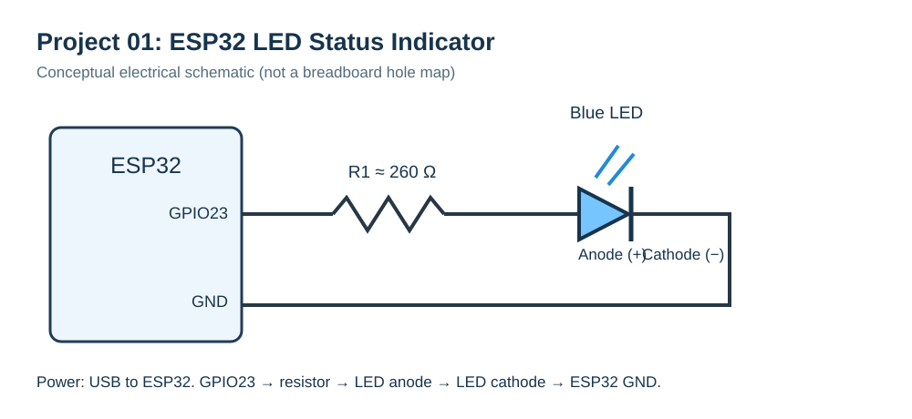

# Project 01 — ESP32 LED Status Indicator

**Build date:** 13 November 2026  
**Platform:** ESP32 development board + Arduino IDE  
**Status:** Physical GPIO23 LED blinking reported working. The sensor-triggered alert feature is **not** implemented.

## Overview

A beginner embedded-systems experiment that controls an external blue LED from ESP32 GPIO23. It starts with a basic 1-second ON / 1-second OFF sketch, then introduces two automatically alternating *demonstration* blink patterns and serial messages.

- **NORMAL MODE (timed demonstration):** LED ON 1000 ms, OFF 1000 ms
- **ALERT MODE (timed demonstration):** 3 flashes with 150 ms ON / 150 ms OFF, followed by a 2-second delay
- **Serial Monitor:** 115200 baud

These modes are *not* sensor readings or automatic real-world hazard detection.

## Schematic

Connection: **ESP32 GPIO23 → ~260 Ω resistor → LED anode (+) → LED cathode (−) → ESP32 GND.**

See [wiring instructions](hardware/wiring.md) and [bill of materials](hardware/BOM.csv). The resistor value is approximate; ensure an appropriate current-limiting resistor for your LED.

## Firmware

- [Basic GPIO LED blinking](firmware/basic_blink/basic_blink.ino)
- [Timed normal/alert LED patterns](firmware/esp32_led_status/esp32_led_status.ino)

### Run it

1. Disconnect USB power before wiring the breadboard.
2. Wire GPIO23, series resistor, LED and GND as shown.
3. Connect the ESP32 using a USB **data** cable.
4. In Arduino IDE, install **esp32 by Espressif Systems**, if necessary.
5. Select an appropriate ESP32 board (e.g. **ESP32 Dev Module**) and the correct COM port.
6. Open either `.ino` in its matching folder and select **Upload**.
7. For the extended sketch, open Serial Monitor at **115200 baud** to view the mode labels.

## Real-build evidence

The builder supplied a physical demonstration video and hardware photos. These are available in the downloadable full project archive shared in the accompanying ChatGPT conversation. **The media are not yet uploaded to this repository.** Add them under `media/` when ready; they should not be interpreted as laboratory validation.

## What I learned

- ESP32 GPIO digital outputs and LED polarity
- Series current-limiting resistors and common ground
- `digitalWrite()`, `pinMode()`, `delay()`, and basic `Serial.println()`
- Why timed demonstrations are different from sensor-driven monitoring

## Limitations

- No button or sensor input is connected in this version.
- The “alert” pattern is timer-generated rather than triggered by a real event.
- Blocking `delay()` calls are not suitable for more demanding multitasking applications.

## Next step

Integrate a button or environmental sensor, implement event-driven alerting with `millis()`, and later explore wireless telemetry. See the [build log](docs/BUILD_LOG.md).

**Provenance:** The sketches are based on code from the accompanying learning session. The schematic and project instructions were prepared for documentation of the physical LED exercise.
