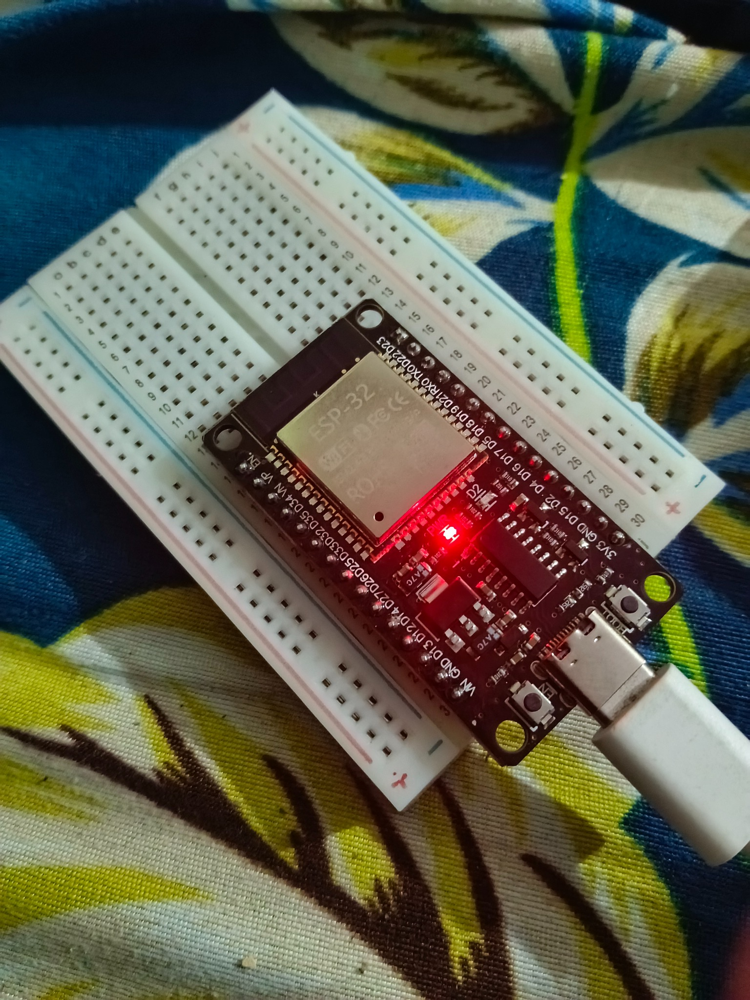
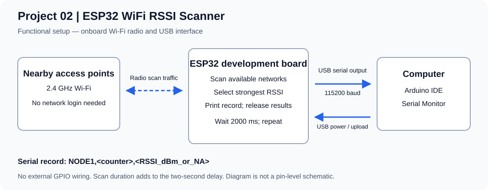

# Project 02 — ESP32 WiFi RSSI Scanner

An ESP32 scans nearby Wi-Fi access points and prints the strongest received signal from each scan to the Serial Monitor. The sketch uses the onboard radio; no external sensor or GPIO wiring is required. The Arduino code is preserved as supplied by the project author.

## Physical build and output




Both files are original user-supplied images, retained without alteration. The photograph shows an ESP32 development board on a breadboard with USB connected and an illuminated onboard indicator. The screenshot shows **ESP32 Dev Module**, **COM5**, **115200 baud**, and these three readings:

```text
NODE1,1,-52
NODE1,2,-53
NODE1,3,-47
```

These are observations from the supplied screenshot, not a new measurement run. See [testing and evidence](docs/TESTING.md).

## Hardware and connections

| Item | Quantity | Purpose |
| --- | --- | --- |
| ESP32 development board with Wi-Fi and USB interface | 1 | Runs the sketch and measures RSSI |
| Compatible USB data cable | 1 | Power, upload and serial output |
| Computer with Arduino IDE | 1 | Builds firmware and displays readings |
| Breadboard | 1, optional | Supports the board as shown in the photograph |

Connect the development board's USB connector to the computer. No external GPIO connections are used by this sketch. Nearby access points provide the signals being measured; no network credentials or Internet connection are needed to run the uploaded firmware.



The diagram describes the functional setup, not the development board's internal circuit. See [wiring notes](hardware/wiring.md) and [bill of materials](hardware/BOM.csv).

## Build and run

1. Install Arduino IDE and the **esp32 by Espressif Systems** board package using [Espressif's installation guide](https://docs.espressif.com/projects/arduino-esp32/en/latest/installing.html). `WiFi.h` is included with that package.
2. Open [esp32_wifi_rssi_scanner.ino](firmware/esp32_wifi_rssi_scanner/esp32_wifi_rssi_scanner.ino). Keep it inside the matching `esp32_wifi_rssi_scanner` folder.
3. Connect the board with a USB data cable. Select the matching board and serial port. The supplied screenshot uses **ESP32 Dev Module**; COM5 is specific to that computer.
4. Verify/compile, then upload. If the board requires it, hold BOOT when the uploader starts connecting, and release after writing begins.
5. Open Serial Monitor at **115200 baud**. After startup, each completed scan produces one record. Boot messages may appear before the records.

Optional Arduino CLI build from this project directory:

```sh
arduino-cli compile --fqbn esp32:esp32:esp32 firmware/esp32_wifi_rssi_scanner
```

This target corresponds to ESP32 Dev Module; choose another target if your board differs.

## How the sketch works

`setup()` starts serial communication, selects station mode, disconnects any existing Wi-Fi connection and waits one second. Each `loop()` then:

1. Runs a blocking `WiFi.scanNetworks()` scan.
2. Compares `WiFi.RSSI(i)` values and keeps the largest value.
3. Prints `NODE1,<packetNumber>,<strongestRSSI>` if networks were found, otherwise `NODE1,<packetNumber>,NA`.
4. Increments the counter, releases scan results with `WiFi.scanDelete()`, and waits 2000 ms.

The interval includes scan time plus the two-second delay, so it is longer than exactly two seconds. The default scan is active; this sketch does not associate with an access point or send application data over Wi-Fi. See [Espressif's Wi-Fi scan API](https://docs.espressif.com/projects/arduino-esp32/en/latest/api/wifi.html#wifiscan).

## Output and interpretation

| Field | Meaning |
| --- | --- |
| `NODE1` | Fixed label identifying this scanner's serial records |
| `packetNumber` | Local record counter, starting at 1 after reset; not a captured network packet number |
| RSSI or `NA` | Strongest scanned RSSI in dBm, or no usable positive scan count |

For these negative dBm readings, a value closer to zero represents a stronger received signal: -47 dBm is stronger than -53 dBm. RSSI varies with obstacles, orientation and the radio environment; it does not directly measure distance or Internet speed.

The strongest access point can change between scans. The sketch does not print SSID, BSSID, channel or timestamps, so it cannot identify or consistently track one router. It uses the radio's default scan settings; the photographed classic ESP32 is a 2.4 GHz Wi-Fi device, and hidden networks are not requested by this call.

`NA` also covers a negative scan result/error because the supplied code treats every non-positive result the same way. It does not distinguish an empty scan from a failed scan. The signed `int` counter is suitable for this short demonstration; very long unattended operation would require handling counter overflow.

## What this project demonstrates

ESP32 station configuration, Wi-Fi scanning, selecting a maximum RSSI, releasing scan memory, and producing simple comma-separated serial records. The photograph and screenshot document a physical prototype and sample output. They do not establish calibrated accuracy, a fixed sampling interval, range, or long-term reliability. Future extensions could track a selected BSSID, timestamp records, distinguish scan errors, and log measurements for plotting.
