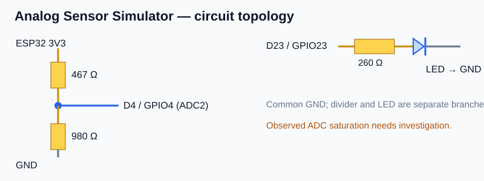

# Project 03 — ESP32 Analog Sensor Simulator + Python Classifier

This hands-on learning project creates a **simulated analog sensor** using a 467 Ω/980 Ω voltage divider. A classic ESP32 measures voltage on **D4 / GPIO4**, activates an external LED via **D23 / GPIO23** when the voltage exceeds 1.5 V, and writes CSV-style lines to Serial Monitor. The separate Python exercise classifies example readings using functions, loops and conditionals.

**Test status:** The user's evidence shows a glowing LED, repeated serial lines `NODE1,4095,3130,ALERT`, and a correct Python classification result (2 alerts). However **4095 is the saturated 12-bit ADC maximum**, and **3130 mV differs from the ~2235 mV predicted by the reported divider**. The analog acquisition itself is **not yet validated**. See [testing](docs/TESTING.md).

## Circuit and components

Classic ESP32, USB data cable, breadboard, jumpers, LED, and measured resistors **467 Ω, 980 Ω, 260 Ω**. See [bill of materials](hardware/BOM.csv) and [wiring](hardware/wiring.md).

```text
ESP32 3V3 -- 467Ω --+-- 980Ω -- GND
                    |
                   D4 (GPIO4 / ADC2)

D23 (GPIO23) -- 260Ω -- LED anode (+) -- LED cathode (-) -- GND
```

Expected divider midpoint: `3.3 × 980 / (467 + 980) ≈ 2.23 V`. Swapping the upper and lower resistors gives approximately **1.06 V**. These are theoretical values, not validated physical measurements.



### Reported breadboard layout

| Connection | Hole(s) |
| --- | --- |
| 467 Ω resistor | B2 to B6 |
| 980 Ω resistor | B6 to B9 |
| 260 Ω resistor | H3 to H7 |
| LED anode / cathode | H7 / H9 |
| ESP32 3V3 / D4 / GND | A2 / A6 / A9 |
| ESP32 D23 / GND | J3 / J9 |

These are the intended correct electrical connections described during troubleshooting; photo detail is insufficient to independently verify every jumper endpoint.

### Arduino firmware

Open [analog_sensor_simulator.ino](firmware/analog_sensor_simulator/analog_sensor_simulator.ino) with Arduino IDE and the **ESP32 by Espressif Systems** core. Select the ESP32 board and COM port, upload, then set Serial Monitor to **115200 baud**.

```text
NODE1,<raw ADC value>,<millivolts>,<NORMAL or ALERT>
```

**Observed line:** `NODE1,4095,3130,ALERT`. This is an output observation, not a calibrated analog result.

**GPIO4 is ADC2 on classic ESP32**, which can conflict with active Wi-Fi. Future Wi-Fi sensor projects should use an **ADC1** pin such as GPIO32 or GPIO33; change both wiring and code. GPIO4 is also a boot strapping pin.

### Python classifier

Run [sensor_classifier.py](software/sensor_classifier.py) with Python 3:

```sh
python software/sensor_classifier.py
```

Its fixed illustrative inputs (millivolts) are `[1050,1080,2230,1100,2180]`. Expected and observed VS Code output:

```text
1.05 V - NORMAL
1.08 V - NORMAL
2.23 V - ALERT
1.10 V - NORMAL
2.18 V - ALERT
Total alerts: 2
```

The Python program **does not connect to the ESP32**. It practices reusable functions `to_volts` and `classify`, parameters, return values, loops and an alert counter.

## Learning checkpoints

1. Predict the alert result if the threshold becomes 2.5 V.
2. Use the multimeter (DC volts) across the divider junction and ESP32 GND. Compare it with 2.23 V and the reported 3130 mV.
3. Disconnect USB, reverse the divider resistor positions, then check for ~1.06 V and LED OFF.
4. Independently write a Python `is_hot(temperature,limit)` function that returns `"HOT"` or `"NORMAL"`.

## Toward environmental monitoring

The divider is a **simulator**, not a soil-moisture or temperature sensor. Once measurement is validated, the next steps are a real environmental sensor, ADC1 with Wi-Fi, serial data logging in Python, then multiple nodes and energy-efficiency experiments.
